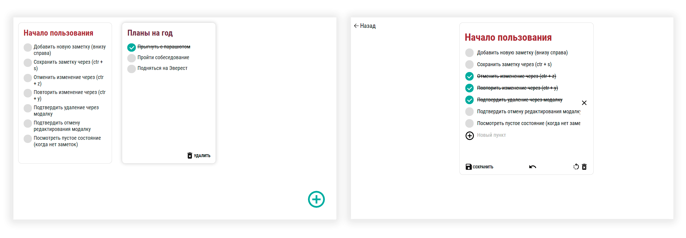
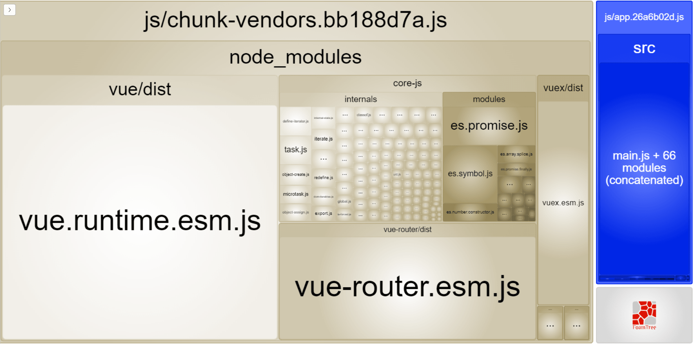

# SPA для ведення нотаток 📝


### Встановлення

```sh
yarn install
```

### Запуск для розробки

```sh
yarn serve
```

### Збірка

```sh
yarn build
```

### Що реалізовано

Дії на головній сторінці:

- [x] перейти до створення нової нотатки
- [x] перейти до редагування
- [x] видалити (потрібне підтвердження)

Дії з нотаткою:

- [x] створити нову нотатку
- [x] зберегти зміни
- [x] скасувати редагування (потрібне підтвердження)
- [x] видалити (потрібне підтвердження)
- [x] скасувати внесену зміну
- [x] повторити скасовану зміну


Дії з пунктами Todo:

- [x] додати
- [x] видалити
- [x] відредагувати текст
- [x] позначити як виконаний

Загальне:

- [x] Дизайн і верстка
- [x] Адаптивна верстка
- [x] Скасування дій за допомогою Ctrl + Z
- [x] Повторення дій за допомогою Ctrl + Y
- [x] Збереження за допомогою Ctrl + S
- [x] Діалогові вікна реалізовані без використання `alert`, `prompt` і `confirm`



Щоб позбутися `/#/` у шляху, потрібно розкоментувати `mode: 'history'` у `router/router.js`.


